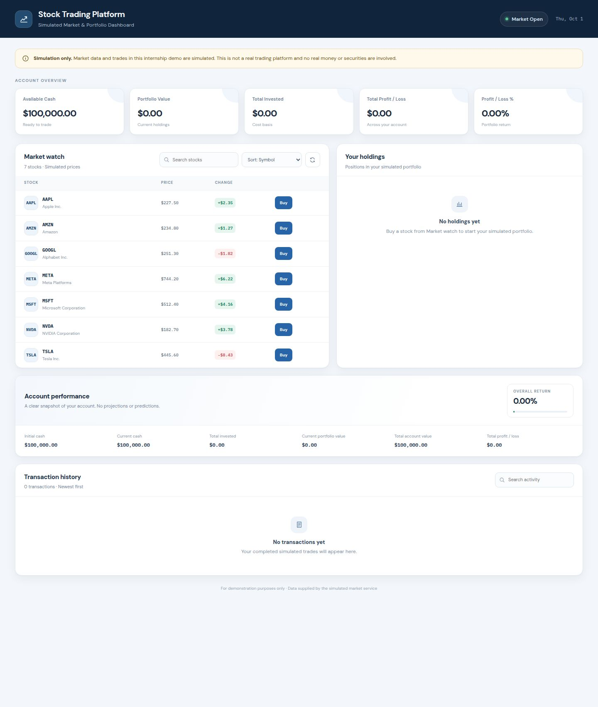
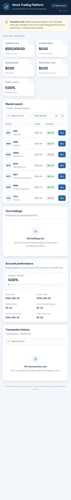

# CodeAlpha Java Stock Trading Platform

## Project Overview

A simulated stock-trading platform with a Java and Spring Boot REST API and a responsive HTML, CSS, and vanilla JavaScript dashboard. Users can browse a small catalog of sample stocks, place simulated buy and sell orders, and review their portfolio and transaction history.

> This application uses simulated stock market data for educational purposes and is not connected to real financial markets.

The account and transaction data are kept in memory. No database, real brokerage, or external financial API is used.

## Features

- Browse and search seven sample stocks with simulated prices and daily changes.
- Sort the market list and filter transaction history.
- Buy and sell whole shares through the dashboard.
- Review available cash, holdings, average buy price, portfolio value, and profit/loss.
- Review overall account performance and transaction history.
- Validate quantities, available cash, and owned shares before completing trades.
- Keep concurrent account reads and trades consistent with synchronized service operations.
- Use the dashboard on desktop and mobile screen sizes.

## Technologies Used

- **Backend:** Java 17, Spring Boot 3.4.5, Maven
- **Frontend:** HTML, CSS, vanilla JavaScript, Vite
- **In-memory storage:** Java collections (`HashMap` and `ArrayList`)

## Java OOP Concepts

- **Classes and objects:** Stocks, users, portfolios, holdings, and transactions are represented by Java classes and objects.
- **Encapsulation:** Model fields are private and are accessed through constructors and getters/setters.
- **Service layer:** Spring-managed services hold the stock catalog and trading rules, separate from the REST controllers.
- **Data transfer objects:** Request and response classes define the API data exchanged with the frontend.
- **Collections:** A map stores holdings by stock symbol, and a list stores transactions.
- **Enums:** `TransactionType` distinguishes buy and sell records.
- **Synchronization:** The singleton trading service serializes account operations so concurrent requests cannot spend the same cash twice.

## Application Structure

```text
artifacts/
├── api-server/
│   ├── pom.xml
│   └── src/main/java/com/codealpha/stocktrading/
│       ├── controller/    REST endpoints and error handling
│       ├── dto/           API request and response objects
│       ├── model/         Stocks, users, holdings, portfolios, transactions
│       ├── repository/    In-memory user and transaction storage
│       └── service/       Stock catalog and trading calculations
└── stock-trading-ui/
    ├── index.html
    ├── app.js
    ├── src/index.css
    └── vite.config.ts
```

## How Trading Simulation Works

1. The demo account starts with **$100,000.00** and an empty portfolio.
2. The API serves seven fixed sample stock records; prices are simulated and are not live quotes.
3. A buy order checks the cash balance, adds shares, updates the weighted average buy price, and deducts the purchase total.
4. A sell order checks the owned share count, adds the sale total to cash, and removes a holding when its last share is sold.
5. Portfolio value, total invested, profit/loss, and account return are calculated from the in-memory account state.
6. State resets when the Java API process restarts.

## API Endpoints

| Method | Endpoint | Description |
| --- | --- | --- |
| `GET` | `/api/healthz` | API health check |
| `GET` | `/api/stocks` | List the sample stocks |
| `GET` | `/api/stocks/{symbol}` | Get a stock by symbol |
| `GET` | `/api/stocks/search?keyword=Apple` | Search stocks by keyword |
| `GET` | `/api/portfolio` | Get cash, holdings, and portfolio profit/loss |
| `GET` | `/api/portfolio/performance` | Get account performance totals |
| `GET` | `/api/transactions` | List successful trades |
| `POST` | `/api/trade/buy` | Buy shares |
| `POST` | `/api/trade/sell` | Sell shares |

Buy and sell requests use JSON with a supported symbol and whole-share quantity:

```json
{
  "symbol": "AAPL",
  "quantity": 2
}
```

## How to Run Locally

Requirements: Java 17 or newer, Maven, Node.js, and pnpm.

From the project root, install the frontend dependencies once:

```bash
pnpm install
```

Start the Java API in one terminal:

```bash
PORT=8080 mvn -f artifacts/api-server/pom.xml spring-boot:run
```

Start the frontend in a second terminal:

```bash
pnpm --filter @workspace/stock-trading-ui run dev
```

Open the local URL printed by Vite (normally `http://localhost:5173`). In local development, Vite forwards `/api` requests to the Spring Boot API on port `8080`. In the Replit workspace, the configured artifact workflows provide the API and frontend routes.

## How to Build

Build the Spring Boot application:

```bash
mvn -f artifacts/api-server/pom.xml package
```

Build the frontend:

```bash
pnpm --filter @workspace/stock-trading-ui run build
```

Check the vanilla JavaScript syntax:

```bash
node --check artifacts/stock-trading-ui/app.js
```

The Maven project currently has no automated test sources. The API routes and trade rules were verified with live requests during the project quality check.

## Example Buy Workflow

Buy two AAPL shares:

```bash
curl -X POST http://localhost:8080/api/trade/buy \
  -H "Content-Type: application/json" \
  -d '{"symbol":"AAPL","quantity":2}'
```

On success, the API returns the transaction and updated available cash. The portfolio endpoint then reflects the new holding and cost basis.

## Example Sell Workflow

Sell two AAPL shares:

```bash
curl -X POST http://localhost:8080/api/trade/sell \
  -H "Content-Type: application/json" \
  -d '{"symbol":"AAPL","quantity":2}'
```

On success, the API returns the transaction and updated available cash. Selling the final shares removes the holding from the portfolio.

## Validation Rules

- Quantity must be a positive whole number.
- The stock symbol must exist in the simulated catalog.
- A purchase is rejected if the account does not have enough cash.
- A sale is rejected if the account does not own enough shares.
- Rejected trades do not change cash, holdings, or transaction history.
- Trades are serialized against the shared in-memory account to prevent concurrent overspending.

## Screenshots

### Desktop



### Mobile



## CodeAlpha Java Programming Internship

This project was prepared as a Java programming internship deliverable and demonstrates a small REST API, object-oriented Java models, and a browser-based trading simulation.

## Task 2

**Stock Trading Platform:** browse sample stocks, simulate trades, and track a portfolio without connecting to real financial markets.